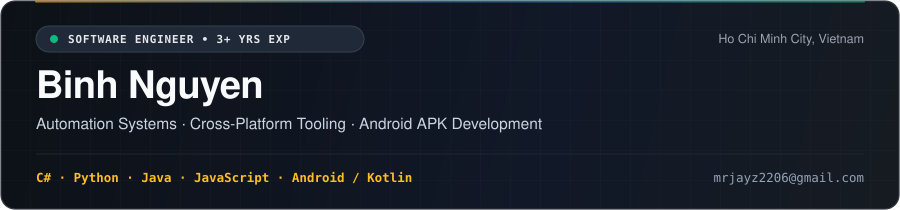

  <picture>
    <source media="(prefers-color-scheme: dark)" srcset="./assets/header-dark.svg" />
    <source media="(prefers-color-scheme: light)" srcset="./assets/header-light.svg" />
    
  </picture>

 

### About

Software Engineer with **3+ years of hands-on experience** building **high-concurrency automation systems**, **cross-platform desktop & backend tooling**, and **native Android applications (APK)** from **Ho Chi Minh City, Vietnam**.

*Kỹ sư phần mềm với hơn **3 năm kinh nghiệm** tại **TP. Hồ Chí Minh**, chuyên xây dựng hệ thống tự động hóa đa luồng hiệu năng cao, phần mềm desktop/backend và phát triển ứng dụng Android APK.*

---

### Core Engineering Areas

| Domain | Focus & Capabilities |
| :--- | :--- |
| **Automation & Distributed Tooling** | High-concurrency task engines, browser & API workflow orchestration, scheduling, data scraping/processing pipelines, resilient retry & resource management |
| **Desktop & Backend Applications** | Performance-focused desktop software, service integrations, real-time monitoring utilities, and clean maintainable tooling across C#, Python, Java, and Node.js |
| **Android & Native APK Builds** | End-to-end Android application architecture, Jetpack Compose UI, background foreground services, local SQLite persistence, R8/ProGuard optimization & release APK signing |

---

### Tech Stack

  

 

| Layer | Technologies |
| :--- | :--- |
| **Languages** | `C#` · `Python` · `Java` · `JavaScript` · `Kotlin` |
| **Platforms & Runtimes** | `.NET` · `Android SDK (APK)` · `Node.js` · `JVM` |
| **UI, Storage & Tooling** | `Jetpack Compose` · `SQLite` · `REST / WebSocket APIs` · `Git` |

---

### Contact

- **Location:** Ho Chi Minh City, Vietnam
- **Email:** [mrjayz2206@gmail.com](mailto:mrjayz2206@gmail.com)
- **GitHub:** [github.com/mrjayz2206-max](https://github.com/mrjayz2206-max)
